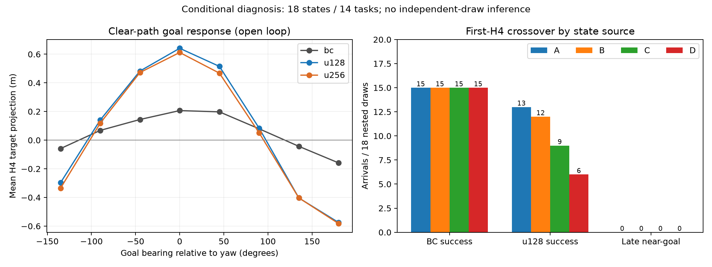

# A1 交叉续飞、目标响应独立分析与研究备忘录评议 v1.0

> 2026-10-23纠偏：本文件验收与复算计数保留，但“侧后方恢复应成为下一阶段主线”等判断已撤回。实验判读应与附件研究讨论分开，原目标闭环与改目标开环不能直接拼成失败因果链。当前解释边界以[纠偏说明v1.1](2026-10-23_A1实验判读与讨论材料分离_纠偏说明_v1_1.md)为准。

日期：2026-10-23。证据域：lightweight_kinematic；冻结 BC、B2560 u128/u256；18个条件化诊断状态、14个独立任务，每状态3个配对draw。本报告不等同于总体成功率、未见世界泛化或Gazebo/PX4能力结论。

## 1. 结论先行

**本批通过独立验收，且确实缩小了研究问题。** 首H4交叉揭示状态形成和后续策略响应都能影响结果；目标响应揭示一种更具体的共同弱点：RL强化了通畅前方目标的推进，但在侧后方目标下仍强烈延续机头前方位移，未可靠地把转向与位置恢复配合起来。这个弱点在u128已经存在，不能全部解释为u128→u256晚期遗忘。

不能由此判定扩散模型、编码器或H4循环规划本身错误；也不能直接决定用BC锚、u128锚、DSRL或X-NavDP替换当前训练。应将后继问题收窄为：**怎样保留前方推进和已学绕障，同时恢复通畅侧后方目标下的有效位置响应。**

## 2. 独立验收：报告可信，但两个口径需明确

[事实] 对`wsl_snapshot/routea_a1_cross_goal_run01/return_sha256.txt`逐文件重算，360/360匹配。执行日志为57 passed、1 skipped；skip对应仅Windows存在的历史轨迹fixture，源码有明确说明。真实bank/GPU对角验证已经执行，不能把该skip说成遗漏GPU检查。环境为Python3.8.20、torch2.4.1+cu121、RTX4060 Laptop GPU。

[事实] 从回传原JSON重新比较run03基线：162个初始动作样本及162次全部续飞记录精确一致，不只比较最终到达。108交叉记录的第一续飞周期与来源对角线对应周期，其初噪、seed、观测来源、pre_state、decision、点云metadata均一致；103实际续飞从cycle1开始且最多11周期；5项吸收保持原终止。

[事实] 154有效目标候选×3draw×3策略=1386样本；462个跨策略配对输入的观测来源及初噪一致；原目标样本动作再次匹配对角线。重算历史目标编码最大误差约2.12e−7，目标投影及连续线段最小球距重算通过。8个无效候选中7个越出目标采样边界、1个已被可见历史轨迹穿过，均保留拒绝记录。

[口径纠正] 5个吸收前缀仍进入四格到达分数，并非从分母剔除；只是它们不能被计作后续策略贡献。另有18个状态但仅14个任务，不能把54次draw或1386个开环样本当成独立环境。

## 3. 交叉续飞：总体均值掩盖了三种具体模式

A=u128首H4→u128续飞；B=u128首H4→u256续飞；C=u256首H4→u128续飞；D=u256首H4→u256续飞。

| 状态来源 | A | B | C | D |
|---|---:|---:|---:|---:|
| BC成功正对照，6状态×3draw | 15/18 | 15/18 | 15/18 | 15/18 |
| u128成功来源，6状态×3draw | 13/18 | 12/18 | 9/18 | 6/18 |
| u256近目标失败来源，6状态×3draw | 0/18 | 0/18 | 0/18 | 0/18 |
| 全部状态draw描述计数 | 28/54 | 27/54 | 24/54 | 21/54 |
| 14任务等权描述分数 | 59.52% | 57.14% | 50.00% | 46.43% |

BC组每格剩余3项为真正time_limit；另外两组未到达均为window_end，不是完整任务超时。两种加权方式不同，不混用。吸收前缀涉及4个配对draw；剔除任一来源已吸收的这4项后，共50项，A/B/C/D=24/23/20/17，差值不变。仅比较实际可切换的同源状态，A/B为27/53与26/53，C/D为20/50与17/50。

**所有到达差异集中在u128成功组的三个状态：**

| state ID | A/B/C/D，分母各3 | 可以支持的局部解释 |
|---|---|---|
| 0ed74985cc7a019b | 3/3/3/0 | 换首段或换后续任一项均救回；u256不是在所有后继状态上都不会完成 |
| 421d10a6e09ac017 | 3/3/0/0 | 结果跟随首段来源；u128也救不回该u256前缀形成的状态，限本窗口 |
| 8abb03ff67e77efd | 1/0/0/0 | 仅一个draw下原u128组合成功，存在组合依赖 |

[判断] 本次首H4分叉已有辨别力，不建议因总体差值不大就立即扩展后期分叉矩阵。它反对“只要换回u128续飞就普遍恢复”，也反对“全部是首段做错”。这只是所选状态的局部干预证据，不能把首段/续飞平均效应解释为总体退化原因的百分比分摊。

晚期近目标组六个状态四格均失败，是两策略共有恢复短板；不是证明状态物理不可恢复。其终点距离也异质：三个状态u256续飞比u128更近，另三个相反。距离接近仍不能替代进入0.5m球。

## 4. 目标响应：前方变强，后方仍前移

[事实] 本批所有154个有效候选的当前点到目标直连均无碰撞，1386条H4/H8计划都未检出碰撞优先事件。**直连通畅不等于视野无障碍或仅有地面**，也不能用本批比较“受阻与通畅”的梯度干扰。

下表仅统计修改目标的候选，剔除original。方位相对当前yaw；各策略共享完全相同候选、历史位置与初噪。

| 方位 | 每策略样本数 | BC正目标投影 | u128正投影 | u256正投影 | BC/u128/u256平均投影，m |
|---|---:|---:|---:|---:|---|
| 正前方0° | 48 | 35 | 48 | 48 | +0.206 / +0.641 / +0.612 |
| 斜前方±45° | 102 | 77 | 102 | 99 | +0.172 / +0.500 / +0.470 |
| 侧方±90° | 102 | 71 | 81 | 78 | +0.074 / +0.111 / +0.083 |
| 后方±135°、180° | 156 | 54 | 5 | 12 | −0.086 / −0.425 / −0.439 |

这些是描述性样本计数，不是独立成功率。后方投影相比BC，u128在18/18状态、14/14任务的平均值更差；u256在17/18状态、13/14任务更差。因状态选择条件化，不能据此外推所有任务。

**位置与yaw必须分开。** 后方目标下，BC/u128/u256平均H4净位移长度0.350/0.639/0.665m；沿初始机头前方投影+0.155/+0.605/+0.607m。三者对初始目标方位的yaw误差平均仍减少约9.60°/10.59°/8.39°，并非完全不转向。这里用原始11D动作第9通道累积的有符号yaw，不能把旧`yaw_change_deg`绝对值当转向符号。

[推断] 最贴近数据的解释是：**转向响应存在，但位置前缀仍强烈向前，目标在后方时转向与平移协调不足。** RL不仅步子更大，后方净位移目标余弦也从BC约−0.122降至u128−0.625/u256−0.589，因此不是只有幅度变化。它可能反映学到的运动延续偏好、恢复覆盖不足、条件映射或更新作用；尚不能选定其中一项为根因。

[竞争解释] 地图直连通畅不代表相机可见后方净空，局部策略可能需要先转向取得观测。小角度转向而暂时前移不自动是错误，12周期也未必足以完成某种大弧转向。不能把地图特权下的“直接后退”指定为普遍正确动作，更不能据此直接训练逐步接近奖励。需要关注持续偏离是否必要、是否在剩余期限内恢复，以及已有更安全有效候选是否被更新压制。

**正投影不等于距离缩短。** 侧方目标平均H4真实端点净接近，BC为+0.019m，而u128/u256为−0.073/−0.097m；即使位移含朝目标的分量，过大的前向/侧向位移仍可把端点带远。另一方面，端点远离也不能否定中途已入球，必须看连续事件。

后方目标H4可入球样本BC/u128/u256为2/0/0，H8为8/2/6。u256的H8局部入球机会甚至多于u128，但没有证明下一周期会兑现。这与“有tail机会不等于闭环恢复”一致，不等于已经证明tail取消是主因。

## 5. 这是否只是修改目标造成的分布外现象？

有此限制：历史目标编码虽然一致，保留的历史运动并非由新目标下策略生成；物理可行不保证策略分布内。探针只回答局部条件响应，不回答修改目标后的真实闭环成功率。

因此额外重读**未修改目标**的162次对角续飞。按每周期真实pre_state、原目标、地图连续直连检查筛选：目标相对yaw在后方≥135°且直连通畅时，BC为65周期/4来源状态，其中11周期H4净位移正投影；u128为143周期/8状态、u256为198周期/10状态，两者正投影均0。RL这些周期全部属于本窗口未到达轨迹。

[证据边界] 周期高度相关，策略访问状态也不同；不能据此直接估计RL对后方恢复的因果效果。不过它说明探针揭示的前向延续确实在原目标失败续飞中出现，不只是人为修改目标后才产生。我们尚未据此审计完整420任务的归因占比。

原始锚点的54个draw中仅3个目标已在后方≥135°；故初始开环总体平均很容易漏掉后续进入的方向恢复问题。

## 6. 对扩散机制与滚动规划的判断

1. **事实：同一H16/H8/H4、同一冻结表征，u128能持续创造入球机会，部分混合策略也成功。** 这反对“该循环协议原则上不能工作”。
2. **事实：u128和u256均有后方位置响应短板，BC也不是可靠的后方专家。** 因此不是只把晚期策略拉回u128就解决全部问题。
3. **推断：循环重规划可能放大方向恢复错误。** 每次转少量yaw却继续向前，下一次观测又在更差位置，可能形成大弧线或远离；本批支持这种行为风险，但未独立操纵重规划周期或旧tail，因此不能裁决循环机制因果作用。
4. **未确定：扩散特有的去噪链优化、H8×11代理、共享参数冲突分别贡献多少。** 本批没有梯度干预，也没有确定性/随机去噪对照。不能将行为变化直接叫作梯度冲突，更不能由concat结构断言网络无法实现几何—目标交互。

当前不应全面换编码器、强制执行H8、增加物理惯性解释，或将每次重新规划视为实现错误。



图中均值仅描述本次条件化状态，非独立样本置信区间；角度各格分母不完全相同，详见上表和复算JSON。

## 7. 对用户研究备忘录的评议

### 7.1 保留的核心思想

保留BC基础导航，同时获得新能力；区分基础侧后方恢复和复杂陷阱脱困；将目标方位干预与整体坐标旋转分开；候选存在性与可部署选择器分开；不把u128作为所有状态的教师。这些判断与新数据相容。

但“优先确认RL破坏基础目标导航”应改得更精确：**前方推进增强与侧后方恢复不足并存。** 不宜把前方已有收益也笼统称为导航退化。此次目标方位探针已经完成，不需再按原备忘录重新做一整轮；整体坐标旋转尚未测试，不能用本次结果冒充旋转等变性检验。

### 7.2 两项技术纠正

备忘录主终点包含“越界安全终止”的泛化表述，不适用于当前已关闭的人工空间阈值；不能重新把合法大范围绕行算成失败。仍使用实际连续首次安全进入0.5m球，不增加悬停/yaw对齐条件。

官方DPPO确有可选`use_bc_loss`：在当前访问观测上采样base教师去噪链，再提高学生对该链的代理似然，默认False。它不是原始示范数据上的普通扩散MSE，也不是强制要求。项目未实现该选项不自动构成错误，“加一行α·BC loss”低估实现与语义差异。[官方源码](https://raw.githubusercontent.com/irom-princeton/dppo/main/model/diffusion/diffusion_ppo.py)

### 7.3 文献核查及可迁移边界

| 路线 | 已核官方材料 | 对本项目的判断 |
|---|---|---|
| X-NavDP/GQRM | 同状态候选Q重加权、结构化探索，另有部署时序引导 | 是值得研究的导航参照，不能直接归因为一个loss有效；E5缺少已训练的无目标分支，当前V critic也不是候选Q |
| DSRL | 冻结基策略，学习初噪策略 | 可减少权重遗忘，但不能保证不产生坏行为，也不保证冻结分布覆盖所需恢复动作 |
| Policy Decorator | 残差学习与受控探索 | 残差幅度小不等于连续安全，需要与三维轨迹及动作通道协调 |
| BDPO | 离线RL、反向转移核KL正则 | 支持行为正则的研究价值，不是本项目在线PPO的直接修复证明 |
| Equivariant DP | SO(2)等变性及操作任务验证 | 提供几何结构参照；当前没有整体旋转实验证据，不应先换架构 |

已核链接：[X-NavDP论文](https://arxiv.org/html/2607.28560v2)、[DSRL官方项目](https://diffusion-steering.github.io/)、[Policy Decorator官方项目](https://policydecorator.github.io/)、[BDPO论文](https://proceedings.mlr.press/v267/gao25q.html)、[Equivariant DP论文](https://proceedings.mlr.press/v270/wang25a.html)。此处核验核心方法，不宣称附件全部文献列表、代码实现或实验可复现性已逐项审计。

X-NavDP确实还使用部署时的旧轨迹一致性引导；它是应独立看待的干预，不能把论文整体收益全部归给GQRM。其探索也依赖目标/无目标轨迹混合与反向扰动。不能对E5简单清空目标输入就认为获得了有效无目标策略，也不能假设轨迹翻转在三维无人机中天然安全。其导航结果值得参考，但作者对DPPO/DSRL的比较不能证明这些方法在本项目必然失败。

### 7.4 BC多候选：先复用，别重复采样

已复查run03每状态20个BC初噪，共360样本：H8安全入球47个，集中5/18状态；两个状态各20/20，其余三个为2、1、4。其余13状态未采到H8入球，**不代表BC支持集没有成功动作**，因为目标可能需要超过H8，且有限采样不是支持集证明。

因此附件提出的候选路线可保留，但不能把“存在一个好H8”直接变成闭环选择收益，也不能先认定DSRL比更新基模型更合适。当前后方探针只有3个draw，更不能据少量BC优于RL就认定BC是通用恢复教师。

## 8. 下一步建议：围绕一个可训练行为收敛

**推荐目标：通畅侧后方目标下，在保留安全前提下，更快恢复位置接近，同时不损失前方推进和已学绕障。** 这比泛泛“稳定长训”更贴近新增证据，也能服务恢复能力目标。

第一步不再扩展整套机制矩阵。利用现有成功/失败轨迹及候选，确定少量代表性退化状态；在训练允许来源中找对应状态，并核查这些状态的原始GAE、标准化优势、位置前缀更新方向以及实际采样覆盖。优先检查“目标在后方仍前移”是否在训练中获得强化，而不是平均拆解全部11通道×去噪阶段。这里只提出定向设计，不启动完整梯度重放。

A2候选由这一核查分流：

- 若BC/u128在匹配训练状态有安全有效候选，而更新把它们推走：优先条件化行为保持或受控更新，保护有用前缀，不要求无差别模仿某个教师。
- 若教师也不具备有效恢复动作：单纯锚定会固定短板，应优先恢复状态覆盖和结构化探索；GQRM是较长期候选，前提是可靠的候选Q，而非直接拿V值排序。
- 若有限候选中已经稳定存在可用动作：再做小规模闭环候选选择验证，区分生成能力与选择能力；全图选择仅作离线诊断上界，不宣称可部署。

不默认增加yaw奖励、目标直接接近奖励或全局BC锚；这些可能惩罚必要绕行，且本批还没证明奖励是根因。也不默认同时增加旋转增强、残差网络和采样引导。

截至10月23日，月底前时间有限。上一轮已测双臂训练约50h、统一评价约10h，本次机制约14.7min；前两项只能作既有预算参考，不能直接当新算法耗时预测。应尽快完成一次针对性的训练设计并留评价/修正时间，而非继续串联所有候选实验。当前仍未授权或启动A2长训，未取得新的训练能力收益。

## 9. 可复算材料

- 本报告对应JSON：`jindu/2026-10-23_A1交叉续飞与目标响应独立复算_v1_0.json`，含逐目标样本、配对差、角度分组、原目标逐周期记录及BC20候选计数。
- 只读分析源码：`chengxu/Improved-3D-Diffusion-Policy/scripts/analyze_routea_cross_goal.py`。不加载权重、不执行新策略、不修改回传数据。
- 在项目根目录运行：

```powershell
& chengxu/Improved-3D-Diffusion-Policy/.venv_routea_eval/Scripts/python.exe -X utf8 chengxu/Improved-3D-Diffusion-Policy/scripts/analyze_routea_cross_goal.py --snapshot wsl_snapshot/routea_a1_cross_goal_run01 --baseline wsl_snapshot/routea_a1_mechanism_val20_run03/same_state_main/recovery --out jindu/2026-10-23_A1交叉续飞与目标响应独立复算_v1_0.json
```

原始回传、权重、训练代码和实验配置未改。新分析含独立交叉复核；所有效果表均为实测描述或明确标识的推断，不将附件观点写成已批准算法。
